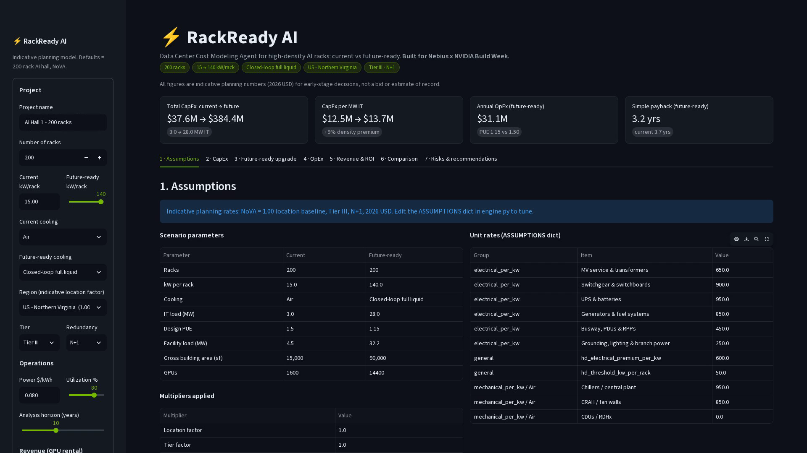
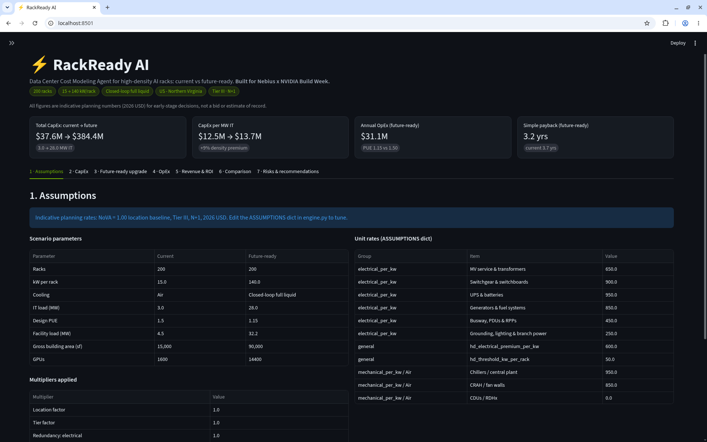
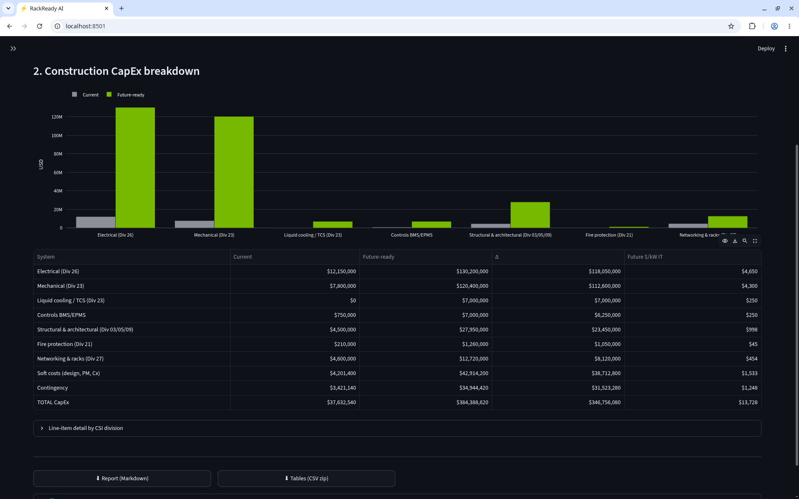
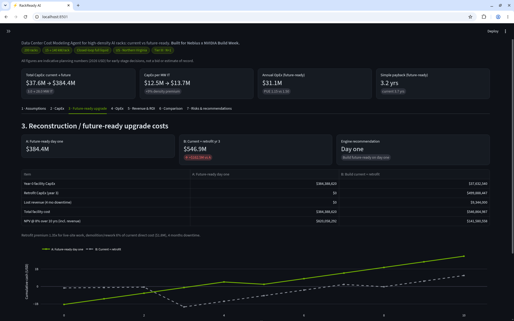
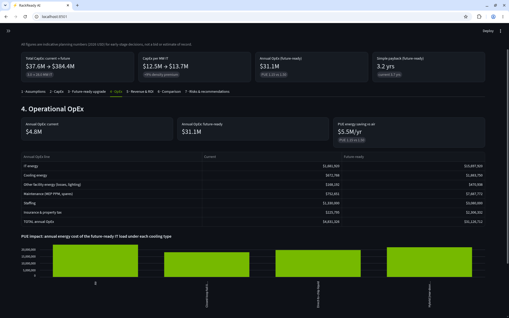
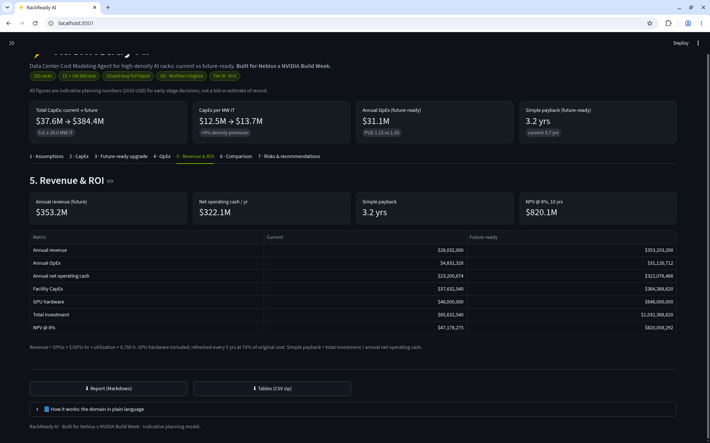
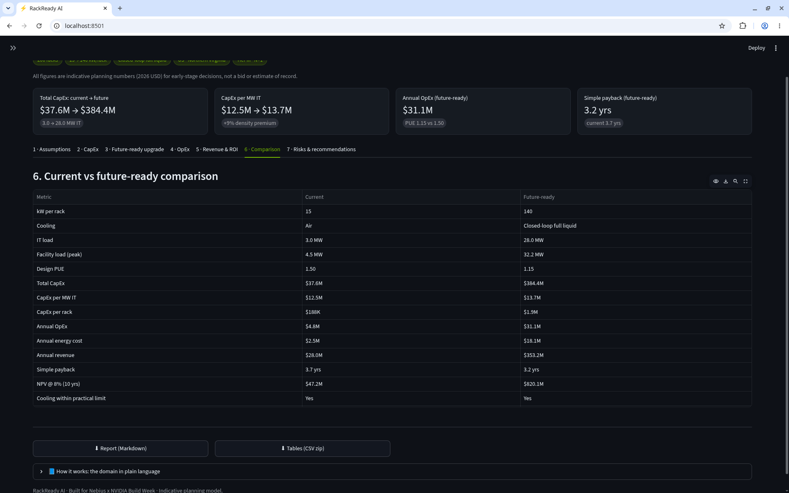
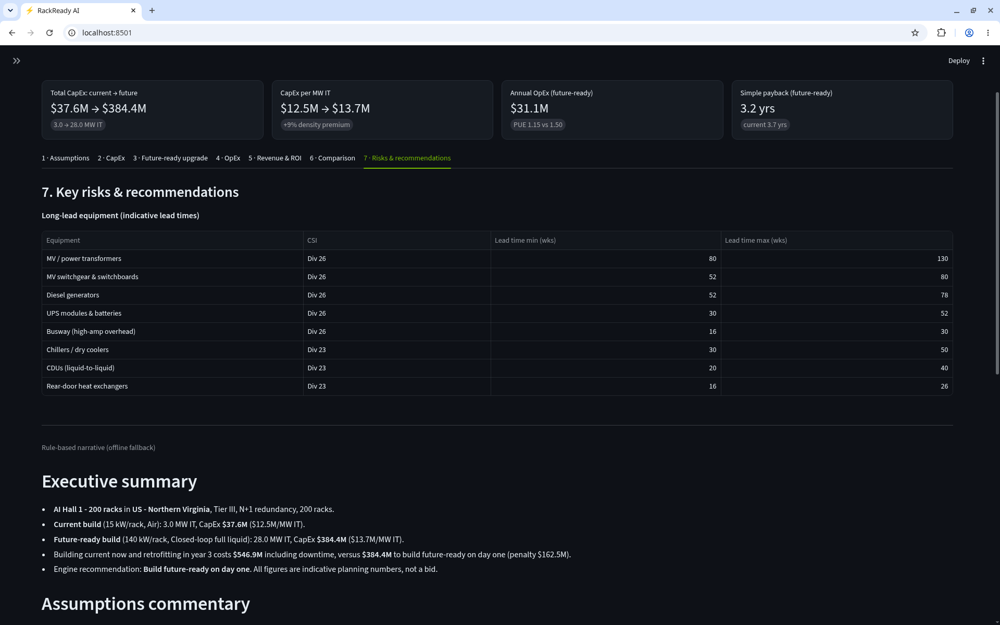

# ⚡ RackReady AI: Data Center Cost Modeling Agent

**Build for 15 kW racks today or 140 kW racks tomorrow? RackReady AI prices both, and NVIDIA Nemotron explains the decision.**

Built for the **Nebius x NVIDIA Build Week** hackathon (2026).



RackReady AI models construction CapEx, the future-ready upgrade path, OpEx and ROI for
high-density AI data center halls. It compares a **current** build (e.g. 15 kW/rack, air) with a
**future-ready** build (e.g. 140 kW/rack, closed-loop liquid) for the same hall.

> All figures are **indicative planning numbers** (2026 USD, Northern Virginia = 1.00), not a bid or estimate of record.

## Why
GPU racks like NVIDIA GB200/GB300 NVL72 draw roughly 120-140 kW, about 10x a traditional rack.
Air cooling tops out near 30 kW/rack, so a hall built for today can need an expensive live-site
retrofit within a few years. Owners, developers and contractors have to make that call early,
with little data. RackReady AI gives them transparent numbers in seconds.

## How it works
1. **Deterministic cost engine** (`engine.py`). This always runs, even without an API key. Unit rates live in one
   commented `ASSUMPTIONS` dict: $/kW IT by CSI division (Div 26 electrical, Div 23 mechanical,
   Div 21 fire, Div 27 networking, Div 03/05/09 structure), plus per-rack items and location, tier and
   redundancy multipliers, soft costs and contingency. From these it computes OpEx (energy via PUE,
   maintenance, staffing), GPU rental revenue, simple payback, NPV, and a
   *future-ready day one* vs *build current + retrofit* comparison.
2. **AI narrative** (`llm.py`). The engine output goes as JSON to an **NVIDIA Nemotron** model on
   **Nebius Token Factory**, using the OpenAI-compatible API with streaming. A domain system prompt casts the model as a
   senior data center cost manager. It writes the executive summary, assumptions commentary,
   upgrade-path recommendation, key risks and next steps, and it is told **never to change the engine's numbers**.
   Reasoning blocks are stripped from the stream.
3. **Graceful fallback.** If the key is missing or the call fails (auth, rate limit, network), a
   rule-based narrative is shown instead, so the app never breaks.

### Example result (defaults)
200 racks · Northern Virginia · 15 → 140 kW/rack · Air → Closed-loop liquid · Tier III · N+1 · $0.08/kWh · 80% utilization

| Metric | Current | Future-ready |
|---|---|---|
| IT load | 3.0 MW | 28.0 MW |
| Total CapEx | $37.6M | $384.4M |
| CapEx per MW IT | $12.5M | $13.7M |
| Annual OpEx | $4.8M | $31.1M |
| Simple payback | 3.7 yrs | 3.2 yrs |

Building current now and retrofitting in year 3 costs **$546.9M** including 4 months of downtime.
That is a **$162.5M penalty**, so the engine recommends building future-ready on day one
(NPV $820.1M over 10 years at 8%). See a live Nemotron narrative in
[`docs/sample_nemotron_narrative.md`](docs/sample_nemotron_narrative.md).

## Screenshots

| | |
|---|---|
| **1 · Assumptions**: every unit rate and multiplier<br> | **2 · CapEx**: by system and CSI division<br> |
| **3 · Future-ready upgrade**: day one vs retrofit<br> | **4 · OpEx**: energy, maintenance, staffing, PUE impact<br> |
| **5 · Revenue & ROI**: revenue, payback, NPV<br> | **6 · Comparison**: current vs future-ready<br> |
| **7 · Risks & recommendations**: long-lead equipment and the narrative (shown here with the offline fallback)<br> | |

## Features
- Inputs: racks, current and future kW/rack, 4 cooling types (air, hybrid rear-door, direct-to-chip,
  closed-loop full liquid), 8 regions with location factors, $/kWh, utilization, analysis horizon,
  Tier II/III/IV, N/N+1/2N, and GPUs per rack and $/GPU-hr for revenue.
- 4 headline cards and 7 report tabs with tables, Plotly charts and expanders.
- Cooling guardrail: the app warns when a cooling type cannot handle the rack density (e.g. air at 140 kW).
- Downloads: the full report as Markdown and all tables as a CSV zip.
- A "How it works" expander explains the domain in plain language.

## Quick start
```bash
git clone https://github.com/koshasolanki/rackready-ai.git rackready_ai && cd rackready_ai
python3 -m venv .venv
source .venv/bin/activate          # Windows: .venv\Scripts\activate
pip install --upgrade pip
pip install -r requirements.txt

# Optional, for the Nemotron narrative (otherwise the rule-based narrative is used)
export NEBIUS_API_KEY="your-key-here"
# or: cp .streamlit/secrets.toml.example .streamlit/secrets.toml  and edit it

streamlit run app.py
```
The app opens at http://localhost:8501. You can also paste a key into **🤖 AI settings** in the sidebar.
Get a key from Nebius Token Factory: **API keys → Create API key**.

The key is looked up in this order: env `NEBIUS_API_KEY`, then `st.secrets["NEBIUS_API_KEY"]`, then the sidebar field.
Never commit `.streamlit/secrets.toml`; it is in `.gitignore`.

## Switching endpoint / model
- **Sidebar → 🤖 AI settings**: edit *Base URL* and pick a model, or choose *Custom...* and type any model id.
- Or set env vars before launching:
  ```bash
  export NEBIUS_BASE_URL="https://api.tokenfactory.nebius.com/v1/"
  export NEBIUS_MODEL="nvidia/Nemotron-3-Ultra-550b-a55b"
  ```
- Defaults: base URL `https://api.tokenfactory.nebius.com/v1/`, model `nvidia/Nemotron-3.5-Super-VL`.
  To list the Nemotron models your account can use:
  ```bash
  curl -s https://api.tokenfactory.nebius.com/v1/models -H "Authorization: Bearer $NEBIUS_API_KEY" \
    | python3 -m json.tool | grep '"id"' | grep -i nemotron
  ```
- Any OpenAI-compatible endpoint works (e.g. NVIDIA NIM `https://integrate.api.nvidia.com/v1`).

## Tuning the model
Edit `ASSUMPTIONS` in `engine.py`. Every rate is commented, and the Assumptions tab shows the live values.
`SAMPLE_INPUTS.md` has three demo scenarios (NoVA, Dallas, Singapore Tier IV 2N) with expected results.

## Project structure
```
rackready_ai/
├── app.py                       # Streamlit UI (cards, 7 tabs, downloads)
├── engine.py                    # ASSUMPTIONS + deterministic cost engine
├── llm.py                       # Nebius/Nemotron client, system prompt, fallback narrative
├── requirements.txt
├── .streamlit/config.toml       # dark theme
├── .streamlit/secrets.toml.example
├── SAMPLE_INPUTS.md             # demo scenarios + 60-second script
├── docs/                        # screenshots + sample Nemotron narrative
└── tests/test_rackready.py      # engine + fallback unit tests (pytest)
```

## Tests
```bash
pip install pytest
python -m pytest -q tests
```

## Tech stack
Python · Streamlit · pandas · Plotly · OpenAI Python SDK · Nebius Token Factory · NVIDIA Nemotron · pytest

## Disclaimer
RackReady AI is an early-stage planning tool. Unit rates are indicative 2026 benchmarks, not quotes.
Validate against local pricing and a qualified estimator before making investment decisions.
