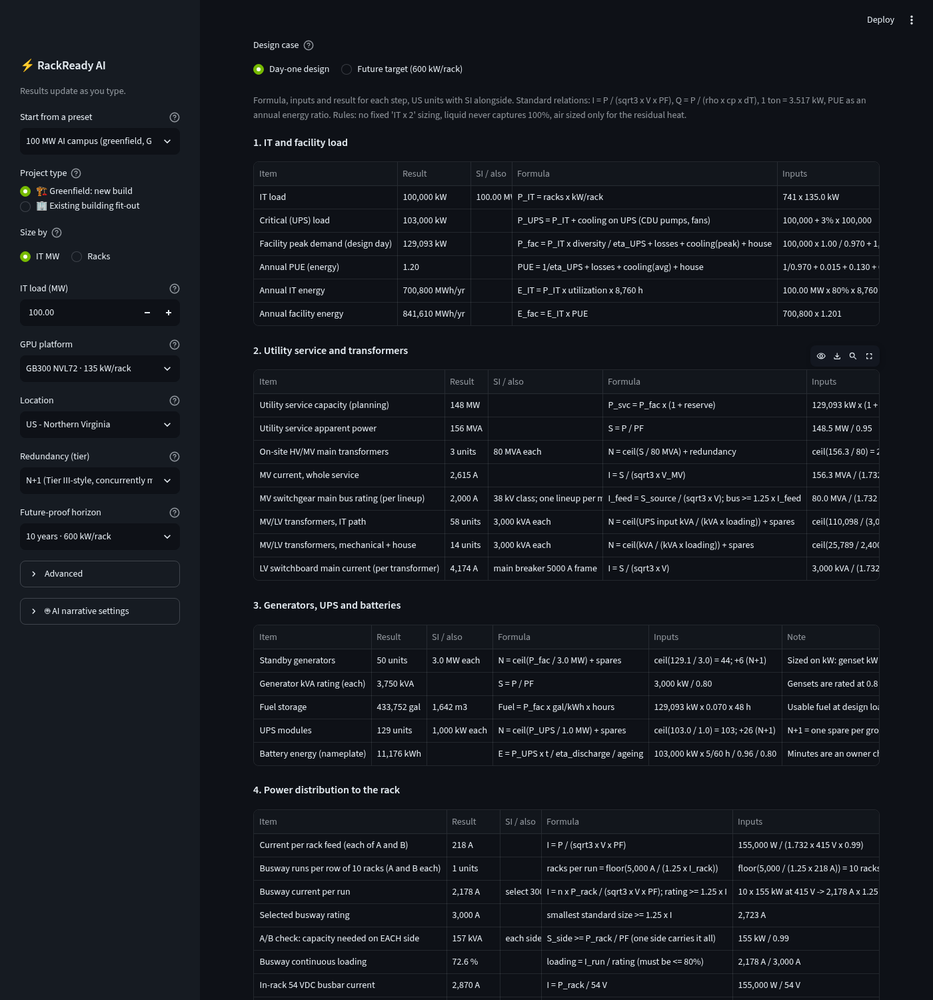
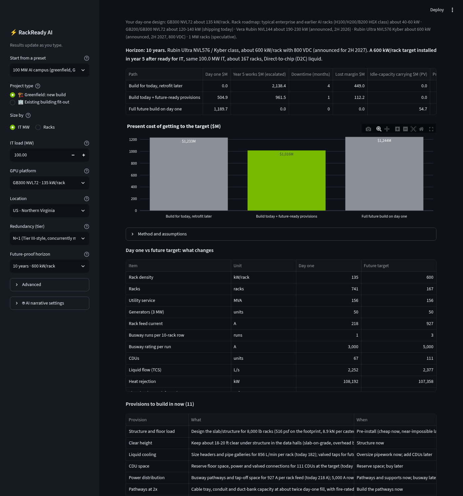

# ⚡ RackReady AI

**Design, price and schedule an AI data center in seconds, from today's 135 kW GB300 racks to tomorrow's 600 kW.**

**Live app:** https://rackready-ai.streamlit.app · Built for the **Nebius x NVIDIA Global AI Hackathon** (2026)


## What it does

Pick a size, a GPU platform, a location, a redundancy
level and a future-proof horizon. In seconds you get:

| Tab | What you get |
|---|---|
| 💰 Costs | 13 end-to-end cost lines with **Include in total** tick boxes; every total everywhere is the sum of the ticked lines |
| 🔮 Future-ready | Retrofit later vs provisions now vs full future build for 5, 10 or 15 years (230, 600, 1,000 kW/rack), and the provisions to build in |
| 📐 Design calculations | Power, cooling, fire, water, stormwater, network, floor and land, step by step with formula, inputs and code basis |
| 🗓️ Schedule & risks | Gantt in months from start, what sets the finish, when to order each long-lead item, auto-enabled risk register, how to avoid delays |
| 📜 Codes & procurement | Latest US code editions, a confirm-locally checklist, US long-lead procurement and verified suppliers (alphabetical) |
| 🏗️ Build & commission | L1-L5 commissioning, the liquid-loop hard stop, load banks, IST scenarios, handoffs, QA checklists |
| 📈 Operations & ROI | Opex, revenue, NPV, payback and cumulative cash flow |
| 📚 Assumptions & sources | Benchmark checks, main assumptions, stage gates, spec quick reference, platforms and sources |

Plus a narrative from **NVIDIA Nemotron** on **Nebius Token Factory**, and exports: one-page PDF, checklist PDF,
full Markdown report and CSV tables.

**Preset results** (default ticks; early budget estimate ±30–50%, 2026 US dollars):

| Preset | Design | Total | Per MW IT | Every line ticked | Payback | Ready for IT | Verdict |
|---|---|---|---|---|---|---|---|
| 100 MW AI campus | GB300 NVL72, 741 racks, D2C, PUE 1.20 | $2.33B | $23.3M | $6.08B | 3.1 years | about 41–51 months from start | Build today + future-ready provisions |
| 10 MW edge AI hall | H200 HGX, 239 racks, rear-door hybrid, PUE 1.35 | $188.1M | $18.8M | $561.6M | 6.7 years | about 26–38 months from start | Build today + future-ready provisions |

## Try it

**Online:** open https://rackready-ai.streamlit.app, pick a preset, change the MW or the platform and watch every
number, chart and export update. Untick GPU hardware or tick on-site power to see the total move. A 60-second demo
path is in [SAMPLE_INPUTS.md](SAMPLE_INPUTS.md).

**Locally:**

Requires Python 3.10+ (tested on 3.13).
```bash
git clone https://github.com/koshasolanki/rackready-ai.git rackready_ai && cd rackready_ai
python3 -m venv .venv
source .venv/bin/activate          # Windows: .venv\Scripts\activate
pip install --upgrade pip
pip install -r requirements.txt

# Optional, for the Nemotron narrative (otherwise the rule-based narrative is used)
export NEBIUS_API_KEY="your-key-here"
# or: cp .streamlit/secrets.toml.example .streamlit/secrets.toml  and edit it

streamlit run app.py
```
The app opens at http://localhost:8501. You can also paste a key into **🤖 AI narrative settings** in the sidebar.
Get a key from Nebius Token Factory: **API keys → Create API key**.

The key is looked up in this order: env `NEBIUS_API_KEY`, then `st.secrets["NEBIUS_API_KEY"]`, then the sidebar field.
Never commit `.streamlit/secrets.toml`; it is in `.gitignore`.

**Switch endpoint or model**
- **Sidebar → 🤖 AI narrative settings**: edit *Base URL* and pick a model, or choose *Custom...* and type any model id.
- Or set env vars before launching:
  ```bash
  export NEBIUS_BASE_URL="https://api.tokenfactory.nebius.com/v1/"
  export NEBIUS_MODEL="nvidia/Nemotron-3-Ultra-550b-a55b"
  ```
- Defaults: base URL `https://api.tokenfactory.nebius.com/v1/`, model `nvidia/Nemotron-3.5-Super-VL`.
  To list the Nemotron models your account can use:
  ```bash
  curl -s https://api.tokenfactory.nebius.com/v1/models -H "Authorization: Bearer $NEBIUS_API_KEY" \
    | python3 -m json.tool | grep '"id"' | grep -i nemotron
  ```
- Any OpenAI-compatible endpoint works (e.g. NVIDIA NIM `https://integrate.api.nvidia.com/v1`).

## How it works

- **Design first, then cost.** Standard engineering formulas size the facility; a per-MW cost basis for the platform,
  split into 22 construction divisions, prices it. Redundancy is priced from the designed generator, UPS and
  transformer counts, then contingency, location, owner costs and escalation are applied. The divisions regroup
  exactly into the 13 cost lines.
- **Greenfield** is one new build from scratch.
- **Liquid above 45 kW/rack.** Air tops out near 30 kW/rack and rear-door coolers near 45 kW; above that every design
  uses direct-to-chip liquid cooling automatically.
- **Future-ready.** The hall is designed again at the target density; three paths are compared on present cost
  (escalated, discounted and weighted by the probability the target arrives).
- **Schedule.** Build months scale with MW (greenfield 12 + 12 x sqrt(MW/100)); long
  leads are reverse-scheduled from when each item is needed on site. Timing is in months from start, never calendar
  dates.

### NVIDIA Nemotron on Nebius Token Factory
- **Model.** The default model is **`nvidia/Nemotron-3.5-Super-VL`**, called through **Nebius Token Factory's
  OpenAI-compatible endpoint** `https://api.tokenfactory.nebius.com/v1/` with the standard OpenAI Python SDK.
  Other selectable Nemotron models are listed in `SUGGESTED_MODELS` in [`llm.py`](llm.py)
  (`nvidia/Nemotron-3-Ultra-550b-a55b`, `nvidia/Nemotron-3_5-Lightning`, `nvidia/NVIDIA-Nemotron-3-Nano-30B-A3B`),
  and any other model id can be typed in the sidebar.
- **Division of labour.** The deterministic engine (`engine.py`) owns every number. Nemotron receives the
  engine output as JSON and writes only the narrative (executive summary, assumptions commentary, design and upgrade
  recommendation, key risks, next steps). The system prompt casts it as a senior data center cost manager and
  forbids it from inventing, recomputing or changing any figure.
- **Streaming.** Output is streamed (`stream=True`) so the report appears as it is written.
- **Reasoning stripped.** Nemotron is a reasoning model; any `<think>...</think>` block is removed from the
  stream before display, so users only see the final answer.
- **Rule-based fallback.** With no key, or on an auth, rate-limit, timeout or network error, a rule-based
  narrative built from the same engine numbers is shown, so the app never breaks.
- **What we learned about `max_tokens`.** A reasoning model spends tokens thinking before it answers. With a
  small limit, the first live run came back blank because the budget ran out during reasoning. Raising
  `max_tokens` to **16000** fixed it; live runs for the default case take **about 10-30 seconds**.
- **Where Token Factory sped up the workflow.** Serverless, pay-per-token access meant no GPU instances to
  provision, no model hosting and no new SDK: one API key and a base URL change gave us several Nemotron sizes
  to try from the same code path.
- **Other Nebius tools.** None beyond Token Factory; no Nebius GPU instances or fine-tuning were used.

**Project structure**

```
rackready_ai/
├── app.py            # Streamlit UI: sidebar, summary, tabs, downloads
├── platforms.py      # GPU platform specs, cost basis per MW, division mix
├── design.py         # step-by-step design calculations (power, cooling, fire, water, site, network, space)
├── buildcx.py        # schedule, when to order, risks, commissioning, handoffs, checklists, stage gates
├── costlines.py      # the 13 end-to-end cost lines and the Include-in-total checklist
├── codes.py          # codes and standards (latest editions) and the Confirm-locally checklist
├── procurement.py    # US procurement table and verified suppliers (the only file with company names)
├── guide.py          # delays and fixes, how to avoid delays, glossary, legal text
├── engine.py         # costs, future-ready paths, OpEx/ROI, schedule, checks, presets
├── report.py         # tables, Markdown report, one-page PDF and checklist PDF (fpdf2)
├── llm.py            # Nebius / Nemotron client, prompt, rule-based fallback
├── ui_views.py       # tab layouts;  ui_common.py  # shared helpers
├── docs/VERIFICATION.md  # numbers, ranges, public sources
├── docs/COMPLIANCE.md    # hackathon rules, licenses, privacy, accessibility, security
├── TERMS.md          # terms of use (same text as in the app)
├── SAMPLE_INPUTS.md  # demo scenarios and expected results
└── tests/            # pytest: physics, ranges, fuzz over input combinations, AppTest for every preset and platform
```

## Verification

- Every number, its range and its public source (or an "assumption" label): [docs/VERIFICATION.md](docs/VERIFICATION.md).
- Tests (`pip install pytest && python -m pytest -q tests`) check the physics (MVA >= MW/PF, tons = kW/3.517, Q = P/(rho cp dT),
  I = P/(sqrt3 V PF)), the public ranges, the D2C switch at 45 kW, a 600 kW case, hand-worked code examples
  (NFPA 13/20/2001, IPC, rational method, MV current, busway loading, order timing), the app for every preset and platform, and a
  **fuzz test** over every project type x platform x redundancy x horizon plus random edge inputs: no errors, no
  NaN, no negative cost lines, ticked lines always equal the total and the one-page PDF stays one page.

### Hand-checked design calculations (default 100 MW GB300 NVL72 campus, N+1)
| Step | Formula | Result |
|---|---|---|
| IT load | 741 racks x 135 kW | 100.0 MW |
| Facility peak | IT / UPS efficiency + losses + design-day cooling + house | 129.1 MW |
| Annual PUE | 1/0.97 + 0.015 + 0.13 + 0.025 (energy ratio) | 1.20 |
| Utility service | 129.1 MW x 1.15 reserve / PF 0.95 | 156 MVA, 3 x 80 MVA transformers (N+1) |
| Generators and fuel | ceil(129.1 / 3 MW) = 44, +6 (N+1); 48 h x 0.070 gal/kWh | 50 x 3 MW; 434,000 gal (1,642 m3) |
| UPS and battery | 103 MW critical load; 5 min / 0.96 / 0.80 | 129 x 1 MW modules; 11,176 kWh |
| Rack feed | I = 155 kW / (sqrt3 x 415 V x 0.99) | 218 A |
| Row busway | 10 racks: 2,178 A x 1.25 | 3,000 A busway |
| Cooling | 105.6 MW / 3.517 | 30,024 tons; 90 MW to liquid, 67 CDUs (1.6 MW, N+1) |
| Liquid flow | Q = 90 MW / (1017 x 3.93 x 10 K) | 2,252 L/s (35,691 gpm) |
| Heat rejection | Q + compressor work | 108.2 MW |
| Water | WUE 0.20 L/kWh (dry/adiabatic) | 140,160 m3/yr (37 M gal) |
| Floor | 3,500 lb on a 0.6 x 1.068 m rack | 507 psf (24.3 kPa) on the footprint |
| Building and land | 2,600 sf per MW; 35% site coverage | 260,000 sf; 26.2 acres |
| MV switchgear | 80 MVA / (sqrt3 x 34.5 kV) = 1,339 A x 1.25 | 2,000 A bus per lineup (38 kV class) |
| A/B rack check | each side carries the whole rack: 155 kW / 0.99 | 157 kVA per side; 300 A breaker |
| Busway loading | 2,178 A / 3,000 A | 72.6% (limit 80%) |
| Chilled water (US) | GPM = tons x 24 / dT (4,434 tons, 12.1 F) | 8,823 gpm (agrees with SI 8,851) |
| Thermal storage | 10 min of chilled-water load, FOM 0.9 | 372 m3 (98,000 gal) |
| Tower make-up (if towers were used) | M = E x CoC / (CoC - 1), CoC 5 | 885 gpm (2.9 gpm per 100 tons rejected) |
| Sprinklers | OH-1 0.15 gpm/sf x 1,950 sf (+30% double-interlock) + 250 gpm hose | 542.5 gpm; 750 gpm fire pump; 32,550 gal for 60 min |
| Clean agent | W = (V/S) x C/(100-C), S = 0.9856 + 0.002441 T | 2,047 lb FK-5-1-12 for 54,000 ft3 at 4.2%, 70 F |
| Stormwater | Q = C i A (C 0.30 -> 0.69, 3 in/h, 26.2 ac) | 54 cfs; about 2.5 acre-ft detention (first pass) |
| Fiber | 72 GPUs x 16 fibers x 1.25 per rack | 1,440 fibers per rack; 853,632 backbone fibers |





## Compliance

Hackathon rules, trademarks, dependency licenses, images and fonts, privacy (no personal data, no analytics),
accessibility (WCAG AA contrast, labelled inputs, alt text), security (no secrets in the code or the git history)
and citation policy: [docs/COMPLIANCE.md](docs/COMPLIANCE.md).

## Terms

[TERMS.md](TERMS.md), also in the app under **📄 Terms of use**. In short: provided as is; an early budget estimate
(±30–50%), not a bid; not engineering, legal or financial advice; a licensed professional engineer and the authority
having jurisdiction (AHJ) must review any design; limited liability; inputs go to the AI provider only to write the
narrative (nothing is stored, no analytics) and the AI text can be wrong. NVIDIA, Nebius, product and supplier names
are trademarks of their owners; RackReady AI is not affiliated with or endorsed by them.

## License

[MIT](LICENSE) © 2026 Kosha Solanki
